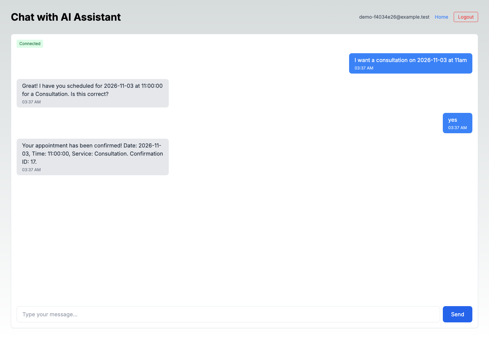

# AI Appointment Booking Assistant

A chat app for booking appointments. You type something like "I'd like a consultation next Wednesday at 11am", and the assistant pulls out the date, time and service, asks for anything missing, checks availability and confirms the booking. It is split into three services plus Postgres, all under `TeraLeads/`.

- `chatbot-frontend/`: Next.js 14, Redux, Tailwind, socket.io client
- `chatbot-backend/`: Express, JWT auth, PostgreSQL, socket.io server
- `chatbot-ai/`: FastAPI and LangChain, handles the conversation and slot filling



Captured from the native app with a disposable local account, PostgreSQL and the local
model: signup, slot collection and a successful database-backed booking.
[Mobile capture](docs/screenshots/chat-mobile.png). No paid model call was used.

## Quick start

```bash
cd TeraLeads
cp .env.example .env
# Set JWT_SECRET and AI_SERVICE_TOKEN to separate values from: openssl rand -hex 32
docker compose up -d --build
```

- Chat UI: http://localhost:3400
- Backend API: http://localhost:3401 (routes under `/api`)
- AI service docs: http://localhost:8400/docs

No API key is required. With `LLM_PROVIDER=auto` the AI service uses OpenAI or Anthropic if a real key is set, and otherwise falls back to a local rule-based LangChain model (`chatbot-ai/src/llm/local_model.py`). Placeholder values like `your-...` count as no key. Set `LLM_PROVIDER` to `openai`, `anthropic` or `local` to force one.

## Native development

Use Node 22, Python 3.11+ and PostgreSQL 15+. Create an empty `chatbot_db` database,
then load `TeraLeads/chatbot-backend/src/database/schema.sql` with `psql -d chatbot_db -f …`.
The database role needs permission to create tables and the GiST exclusion constraint.

Configure `TeraLeads/.env`: set `DB_HOST=127.0.0.1`, your local database port, database
name, user and password; generate both secrets as above. For the native ports below, set
`AI_SERVICE_URL=http://127.0.0.1:8400`, `BACKEND_API_URL=http://127.0.0.1:3401/api/`,
`CORS_ORIGIN=http://localhost:3400`, and `CORS_ORIGINS=http://localhost:3400`.
Use `LLM_PROVIDER=local` to keep the demo independent of paid providers.

Run these in three terminals from the indicated folders:

```bash
# TeraLeads/chatbot-ai
python3 -m venv .venv
. .venv/bin/activate
pip install -r requirements.txt
uvicorn main:app --app-dir src --env-file ../.env --port 8400

# TeraLeads/chatbot-backend
npm ci
PORT=3401 DOTENV_CONFIG_PATH=../.env node -r dotenv/config src/index.js

# TeraLeads/chatbot-frontend
npm ci
NEXT_PUBLIC_API_URL=http://localhost:3401 NEXT_PUBLIC_WS_URL=ws://localhost:3401 npm run dev -- --port 3400
```

For an existing database, back it up and review
[`17000000000000_booking-consistency.js`](TeraLeads/chatbot-backend/src/database/migrations/17000000000000_booking-consistency.js).
It adds a retry key and rejects overlapping active appointments. Existing overlaps or null/invalid
durations must be resolved before applying it; the migration deliberately does not delete records.
Run the migration through `node-pg-migrate` with `--migrations-dir src/database/migrations`
and your `DATABASE_URL`; databases created directly from `schema.sql` need their migration
baseline recorded before using the migration runner.

## What makes a booking durable

```mermaid
sequenceDiagram
    participant U as Signed-in user
    participant N as Express API
    participant A as Conversation service
    participant P as PostgreSQL
    U->>N: Confirm appointment
    N->>A: User context + service authentication (headers)
    A->>N: Create appointment + stable retry key
    N->>P: Transaction + idempotency lock + overlap constraint
    alt booking saved or replayed
        P-->>N: Durable appointment ID
        N-->>A: Saved appointment
        A-->>U: Booking details + database ID
    else conflict or unavailable
        A-->>U: Booking not confirmed; retry or choose another time
    end
```

`Idempotency-Key` accepts up to 128 characters. Replaying the same key and details returns
the same appointment; changing the details under that key returns 409. PostgreSQL's exclusion
constraint also protects reschedules and cancelled-to-active transitions across independent
requests. API tokens travel in HTTP headers, never in the model prompt.

## API overview

Backend:

- `POST /api/auth/signup`, `POST /api/auth/login`
- `POST /api/chatbot/token`, `POST /api/chatbot/message`
- `/api/appointments`: create, list, `GET /availability`, get, update, delete by id

AI service: `POST /chat` (backend service authentication required) and `GET /health`.

Chat messages go over socket.io when connected, with plain HTTP as a fallback. The backend forwards each turn to the AI service (`chatbot-backend/src/services/aiClient.js`) and saves both sides in Postgres.

## Running the tests

```bash
# AI service
cd TeraLeads/chatbot-ai
pip install -r requirements.txt
pytest

# Backend
cd TeraLeads/chatbot-backend
npm install
RUN_DATABASE_TESTS=1 npm test -- --runInBand
# DB_* must point to a disposable PostgreSQL database with schema.sql applied.
# Set JWT_SECRET to a generated local value before running backend tests.

# Frontend (Jest unit tests; Playwright e2e with npm run test:e2e)
cd TeraLeads/chatbot-frontend
npm install
npm test
```

## Limitations

- The local model only understands the phrasings it has patterns for. For anything else it asks a follow-up question instead of guessing.
- PostgreSQL is the booking authority. The JSON store remains a development fixture; confirming
  through chat does not write a second, unsynchronised booking there.
- This is one shared calendar. `business_id` is metadata, not a separate scheduling resource.
- Dates and times are wall-clock values in `BUSINESS_TIMEZONE` (UTC in the example). Relative
  dates use that zone in both services. Per-user timezone conversion and ambiguous DST times
  need additional product rules before deployment.

## Author

[**Muhammad Nadeem**](https://github.com/dev-mnadeem)
